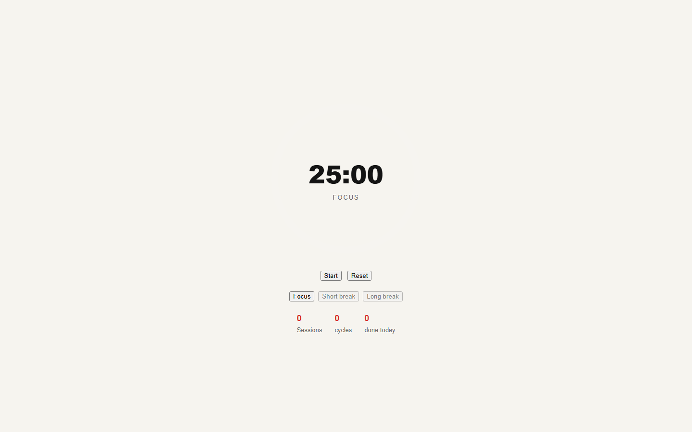
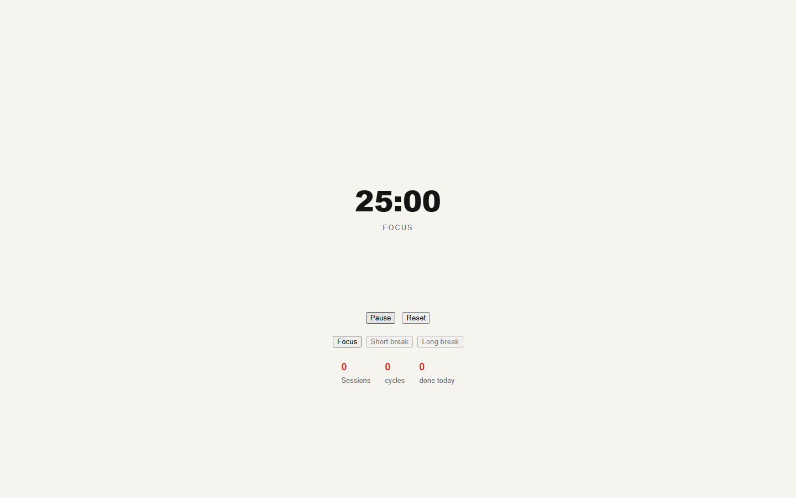
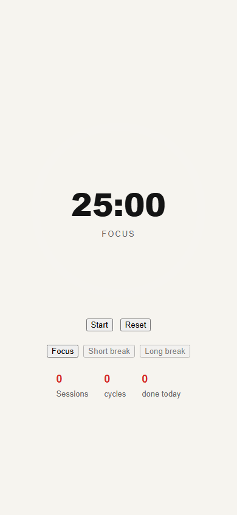

# Volt Verdant — Pomodoro Flow

A React pomodoro focus timer: animated SVG progress ring, focus/short/long modes, automatic cycle rotation and session statistics.

<div align="center">


**[Live Demo](https://ruslanfridenli.github.io/volt-verdant/)** · **[Deutsch ↓](#-deutsch)**

</div>

---

## Screenshots







## Features

- Animated SVG progress ring
- Focus / short break / long break modes
- Automatic pomodoro cycle rotation
- Session and cycle counters
- Keyboard-friendly controls
- English/German interface

## Local development

```bash
git clone https://github.com/ruslanfridenli/volt-verdant.git
cd volt-verdant
# open index.html in a browser, or serve statically:
npx serve .
```

No build step, no dependencies — pure static site.

---

## 🇩🇪 Deutsch

### Volt Verdant — Pomodoro Flow

Ein React-Pomodoro-Timer: animierter SVG-Fortschrittsring, Fokus-/Kurz-/Langpausen-Modi, automatischer Zykluswechsel und Sitzungsstatistik.

### Funktionen

- Animierter SVG-Fortschrittsring
- Fokus-/Kurz-/Langpausen-Modi
- Automatische Pomodoro-Zyklen
- Sitzungs- und Zykluszähler
- Tastaturfreundliche Steuerung
- Englische/deutsche Oberfläche

### Lokale Entwicklung

```bash
git clone https://github.com/ruslanfridenli/volt-verdant.git
cd volt-verdant
npx serve .
```

Reine statische Seite — kein Build-Schritt, keine Abhängigkeiten.

---

## ☕ Support / Unterstützen

Wenn dir diese Website beim Lernen hilft, würde mir eine Spende sehr viel bedeuten und dabei helfen, sie weiterzuentwickeln. Alternativ kannst du das Projekt mit einem Stern im github repo unterstützen. Vielen Dank!

- Solana: `zQpgZ6nGigww7vYpz3Qqxb1BT44kqS567vFaLTeHagS`
- Ethereum: `0x9c4fE1B2e9a1A9c22312c8296BB088Ca0e8F1B4e`
- Bitcoin: `bc1p2jltk9ya9kyzv35d8kxn7mmg9jqkx66cqtgzqwe75zlr4v9jk4hsv468q7`

---

Made with care. Feedback welcome via issues.
